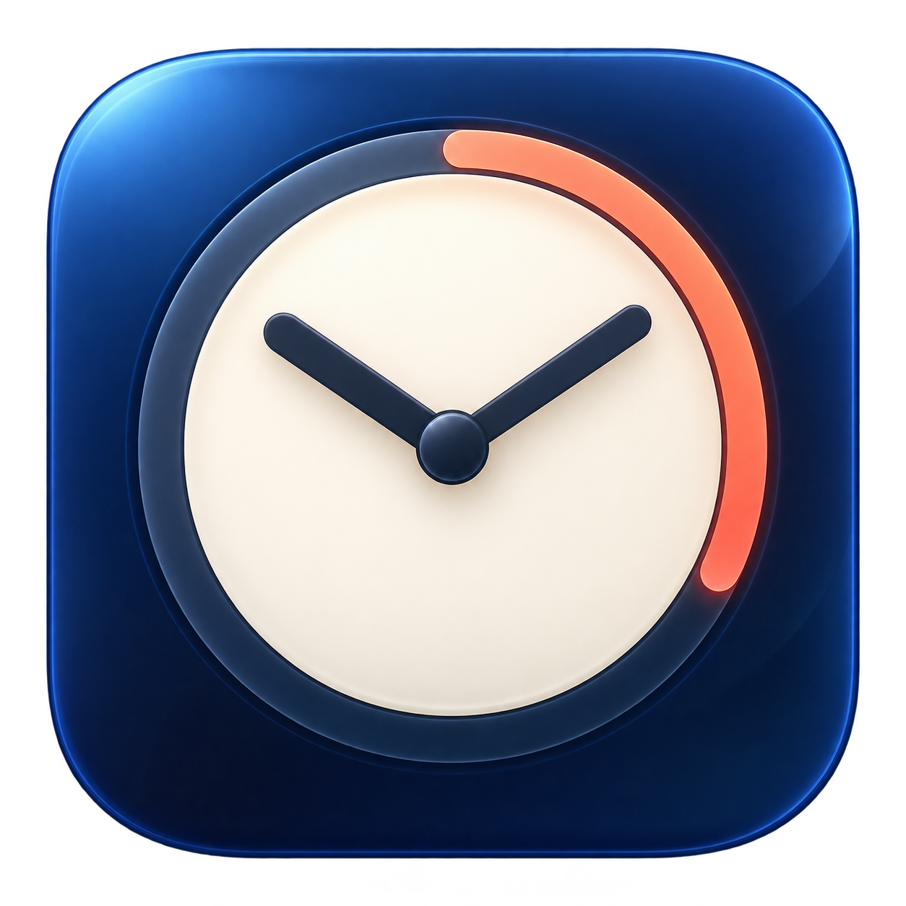

<div align="center">



# Pomodoro

A native macOS menu bar timer with a task list that stays with you.

**macOS 26+ · Apple Silicon download · SwiftUI · [MIT](LICENSE)**

[**Download for Mac**](https://github.com/rayanical/pomodoro/releases/latest) · [Get started](#get-started) · [Build from source](#build-from-source)

</div>

Set your focus time, add a few tasks, and get to work. Pomodoro lives in the menu bar, shows your remaining time at a glance, and saves your checklist between sessions. No account, cloud service, or Dock icon.

## Features

- **Focus and break timers** — Set each duration from 1–999 minutes. Pause, resume, or reset whenever you need; focus and break periods alternate automatically.
- **Countdown at a glance** — A clock icon when idle, the remaining time when running or paused.
- **Tasks beside your timer** — Add, edit, check off, and reorder tasks with a live row preview while dragging.
- **A compact popup** — Room for four tasks without resizing, then grows for additional tasks without scrolling, up to the available screen height.
- **Your setup, remembered** — Tasks, completion, order, durations, draft text, and preferences save locally.
- **Small conveniences** — Optional sorting of completed tasks to the bottom, inline delete confirmations, phase notifications, and launch at login.

## Get started

The downloadable app requires **macOS 26 or later** and **Apple Silicon (M1 or later)**.

1. Download **Pomodoro.zip** from the [latest release](https://github.com/rayanical/pomodoro/releases/latest).
2. Unzip it and move **Pomodoro.app** into **Applications**.
3. Launch the app and click its **clock icon in the menu bar**.
4. Set Focus and Break minutes, add a task, and press Play.

> [!IMPORTANT]
> The release is ad-hoc signed, **not Apple-notarized**. If macOS blocks the first launch and you trust the build, try opening it once, then use **System Settings → Privacy & Security → Open Anyway**. See [Apple's first-launch instructions](https://support.apple.com/en-us/102445).

Launch at login is enabled on first launch. Change it in the **…** menu or macOS Login Items. Notification permission is requested when you start a timer.

## Everyday controls

| To… | Do this |
| --- | --- |
| Pause or continue | Click Pause; the same button becomes Resume. |
| Reset | Click the circular arrow to return to the full Focus duration. |
| Add a task | Type in the task field, then press Return or click **+**. |
| Complete a task | Click its circle. |
| Edit a task | Double-click its title to reveal Edit, or right-click and choose Edit. |
| Reorder tasks | Drag a title, or right-click and choose Move up/down. |
| Delete tasks | Click **×** or **Clear done**, then confirm inline. |
| Change preferences or quit | Open the **…** menu. |

> [!NOTE]
> Tasks and settings survive quitting. An active or paused timer does **not** resume after the app quits.

## Data and permissions

Tasks and settings are saved locally on your Mac. The app has no analytics or network service. macOS manages notification and login-item permissions.

Version 1.12 imports tasks and preferences from earlier versions automatically, keeping the original data as a fallback. macOS may ask you to allow notifications again after this update.

Long titles stay on one row; hover to read the full title. The checklist grows rather than scrolls, so very long lists are limited by your screen height. Running timers use a deadline to catch up after sleep; macOS may deliver only the next scheduled phase notification while asleep.

## Build from source

Requires **macOS 26+**, **Swift 6.2 command line tools**, **Python 3**, and **Git**. There are no third-party package dependencies.

```sh
git clone https://github.com/rayanical/pomodoro.git
cd pomodoro
zsh scripts/build-app.sh
```

The script builds for your Mac's architecture, generates the icon, signs the app ad hoc, and creates:

- `build/Pomodoro.app` — move this to Applications to install.
- `build/Pomodoro.zip` — the packaged app for distribution.

Rebuilds keep the same bundle identifier so your existing tasks and preferences remain available.

### Run the checks

From the repository root:

```sh
CLANG_MODULE_CACHE_PATH="$PWD/.build/module-cache" \
SWIFTPM_MODULECACHE_OVERRIDE="$PWD/.build/module-cache" \
swift run --disable-sandbox --cache-path .build/cache PomodoroCoreTests
```

The executable test runner covers timer boundaries, sleep recovery, pause/resume/reset, task encoding, editing, reordering, completed-task grouping, and migration from earlier app versions. It works with Command Line Tools installations that lack usable XCTest/Swift Testing modules.

### Find your way around

| Location | Purpose |
| --- | --- |
| [`Sources/PomodoroCore`](Sources/PomodoroCore) | Timer state and checklist logic. |
| [`Sources/PomodoroTasks`](Sources/PomodoroTasks) | SwiftUI interface, local storage, notifications, and login item. |
| [`Tests/PomodoroCoreTests`](Tests/PomodoroCoreTests) | Core checks. |
| [`scripts`](scripts) | App and icon packaging. |
| [`Assets`](Assets) | App icon, including its AI generation prompt. |
